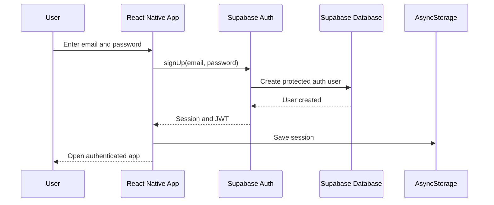
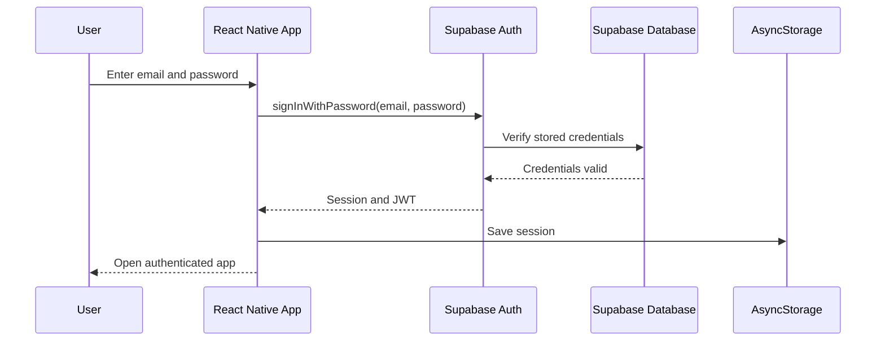
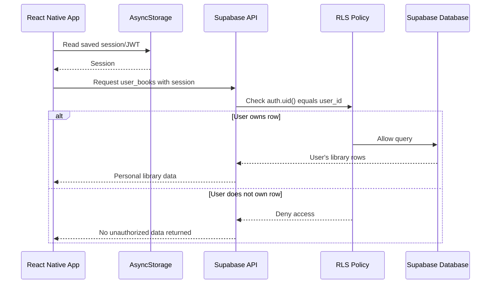

## Access Control

Reademption uses Supabase Auth for account creation, sign-in, session management, and JWT-based authentication. The React Native app stores the signed-in session in AsyncStorage. Supabase Row Level Security protects user-specific library data.

### Sign-Up Flow

### Sign-In Flow

### Protected Personal-Library Request

### Implementation Notes

- Supabase Auth manages account creation, password security, session creation, and JWT issuance.
- AsyncStorage persists the user session on the mobile device.
- Shared book metadata is stored in `books`.
- User-specific reading data is stored in `user_books`.
- RLS policies use `auth.uid() = user_id` so users can access only their own library records.
